# 덕후감


## 소개

책을 덮고 나면 누군가와 이야기하고 싶어집니다.\
나만 좋았던 장면인지, 다른 사람은 어떻게 읽었는지 궁금해집니다.\
하지만 주변에서 같은 책을 읽은 사람을 찾기는 쉽지 않습니다.

덕후감은 책에 진심인 오덕들의 소통 공간입니다.\
읽은 책에 평점과 감상을 남기고, 댓글과 좋아요로 이야기를 이어갑니다.\
다른 독자의 리뷰와 인기 도서를 살펴보며 다음에 읽을 책도 발견할 수 있습니다.

| 항목      | 내용                                                                                                                                                                                          |
| :-------- | :-------------------------------------------------------------------------------------------------------------------------------------------------------------------------------------------- |
| 개발 기간 | 2026.10 ~ 2026.11                                                                                                                                                                             |
| 관련 링크 | [서비스](https://ohdeok.p-e.kr/) · [시연 영상](https://ohdeok.p-e.kr/) · [API 문서](http://sprint-project-1196140422.ap-northeast-2.elb.amazonaws.com/sb/deokhugam/api/swagger-ui/index.html) |

## 팀원

| [김수영](https://github.com/Ssu126) | [김승호](https://github.com/WinLike-dev) | [박태양](https://github.com/parksunovo) | [조준희](https://github.com/Joonehee-JO) |
| :---: | :---: | :---: | :---: |
| <a href="https://github.com/Ssu126"></a> | <a href="https://github.com/WinLike-dev"></a> | <a href="https://github.com/parksunovo"></a> | <a href="https://github.com/Joonehee-JO"></a> |
 - 오덕들 힘내자 · 2026.10.20 ~ 2026.11.09 · 주 단위 스프린트 5회
## 주요 기능

### 도서

- 도서 검색·상세 조회 및 등록·수정·삭제
- 카카오 책 검색 API를 통한 ISBN 정보 조회, OCR 기반 ISBN 이미지 인식
- S3를 이용한 도서 썸네일 저장

<details>
<summary>화면 보기</summary>

**도서 목록**

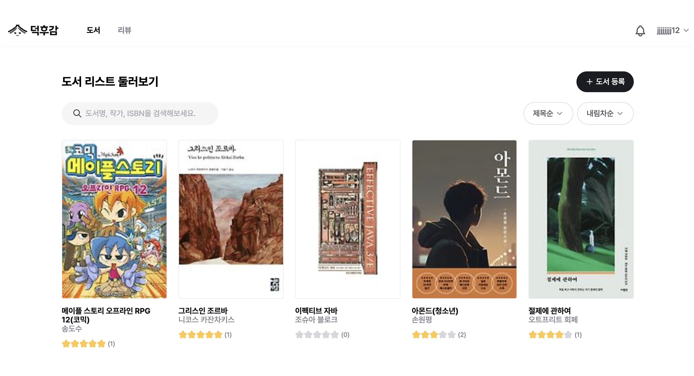

**도서 등록**

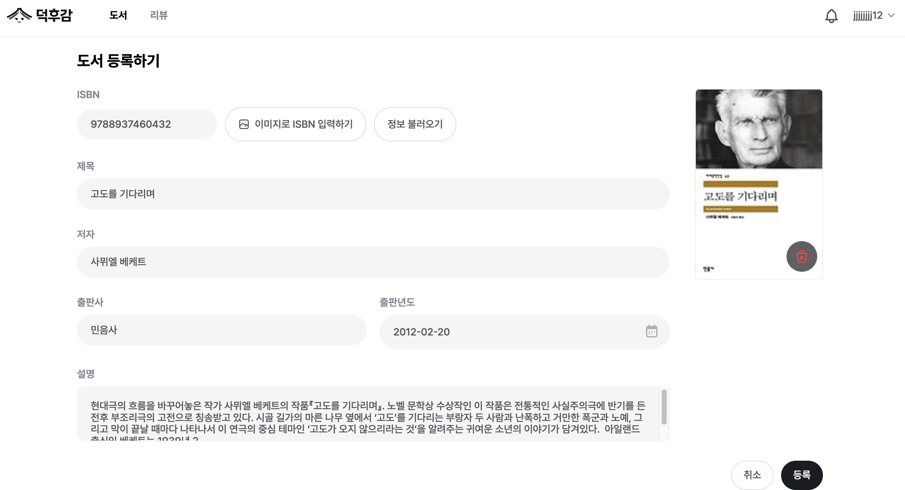

</details>

### 리뷰

- 도서별 평점·리뷰 작성 및 수정·삭제
- 검색·정렬과 커서 기반 리뷰 목록 조회
- 리뷰 좋아요

<details>
<summary>화면 보기</summary>

**리뷰 목록**

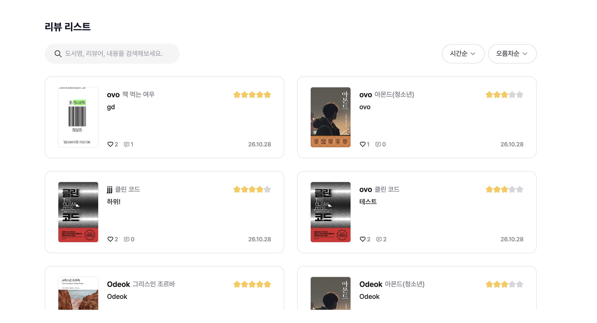

**리뷰 상세·작성**

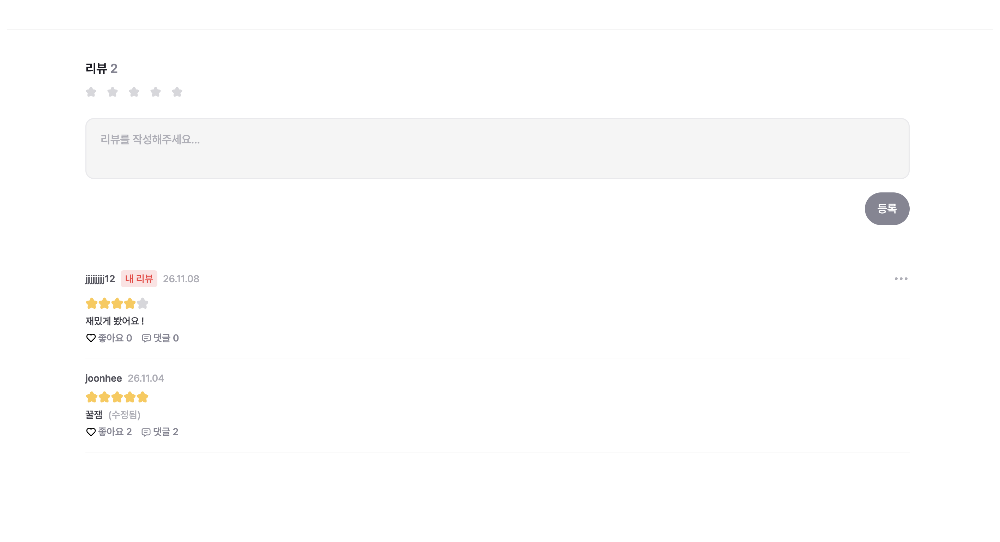

</details>

### 댓글

- 리뷰에 댓글 작성 및 수정·삭제
- 커서 기반 댓글 목록 조회

<details>
<summary>화면 보기</summary>

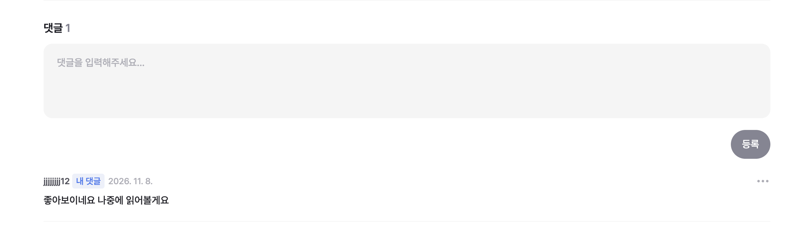

</details>

### 사용자

- 회원가입·로그인 및 프로필 조회·수정
- 회원 탈퇴 및 탈퇴 사용자 데이터 정리

<details>
<summary>화면 보기</summary>

**회원가입**

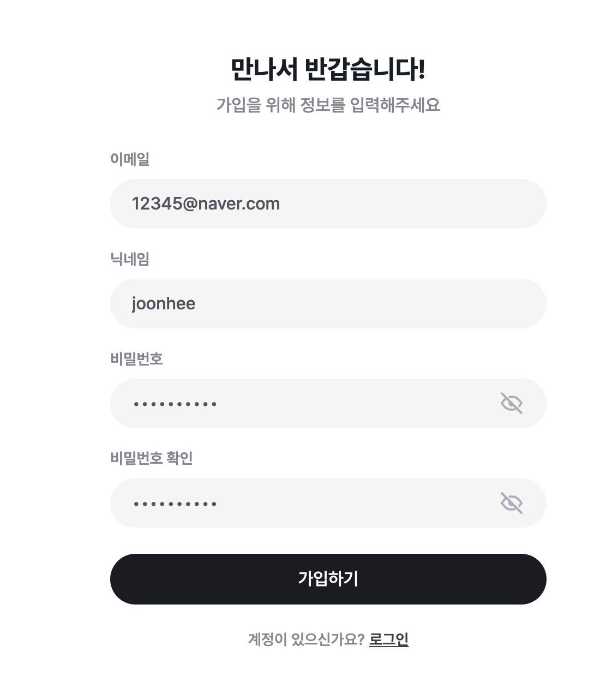

**로그인**

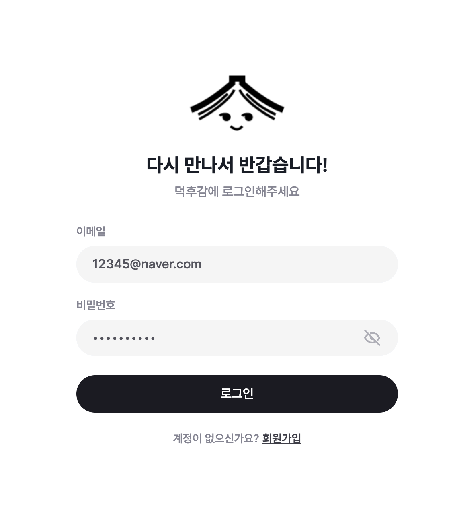

</details>

### 알림

- 리뷰의 댓글·좋아요 및 인기 리뷰 순위 진입 알림
- 알림 목록 조회와 개별·전체 읽음 처리

<details>
<summary>화면 보기</summary>

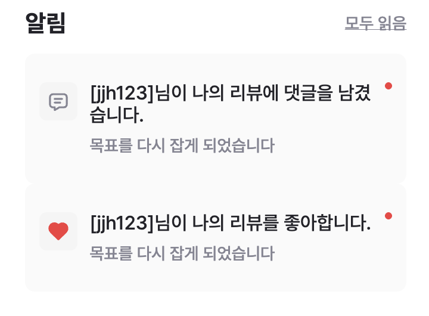

</details>

### 대시보드

- 일간·주간·월간·역대 인기 도서·리뷰 및 파워 유저 조회
- 배치를 통한 인기 도서 집계와 기간별 상위 20위 저장

<details>
<summary>화면 보기</summary>

**인기 도서**


**인기 리뷰**

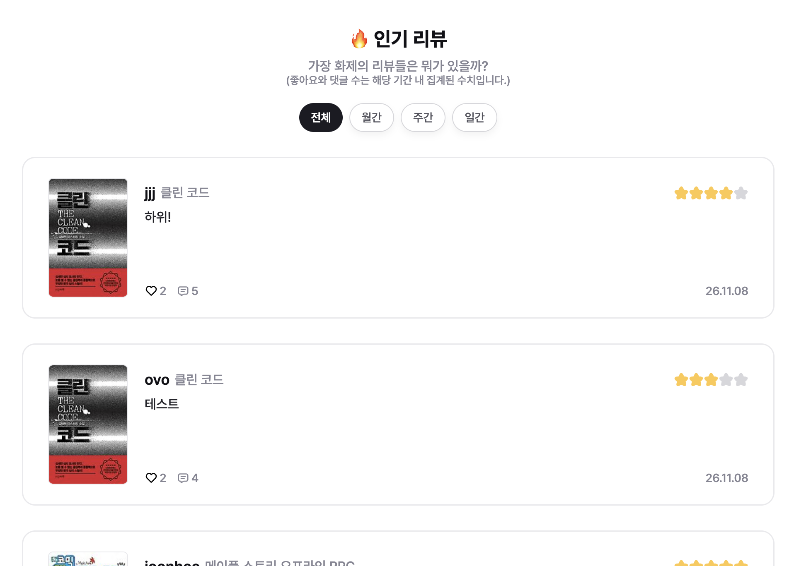

**사용자 활동 순위**

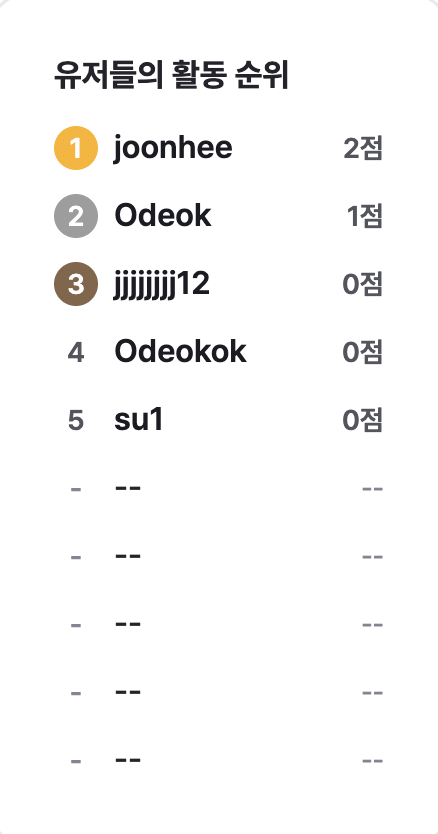

</details>

## ERD

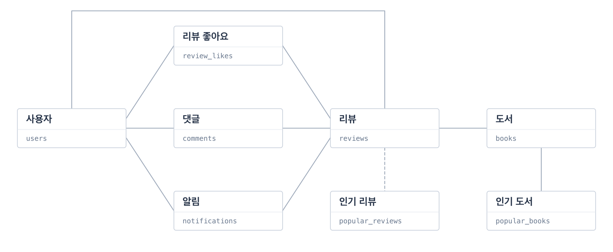

<details>
<summary>세부 ERD 보기</summary>

<!-- draw.io에서 내보낸 ERD 이미지를 docs/assets/erd-detail.png로 저장하고 아래에 연결합니다. -->
세부 ERD 이미지를 추가할 자리입니다.

</details>

## 시스템 아키텍처

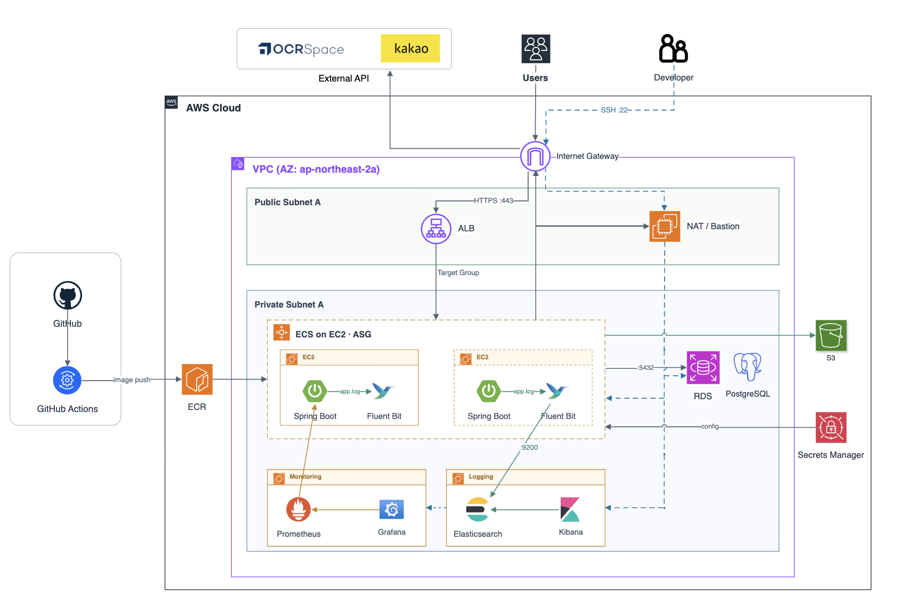

- **서비스·배포:** ASG로 태스크 실행 용량을 공급하고, ALB와 연동해 롤링 배포합니다.
- **지표:** Prometheus가 Spring Boot Actuator의 지표를 수집하고 Grafana로 확인합니다.
- **로그:** Fluent Bit가 공유 볼륨의 로그를 Elasticsearch와 S3로 전달하고, Kibana에서 조회합니다.
- **관리 접속:** NAT/Bastion 인스턴스를* 경유해 프라이빗 EC2에 접속합니다.

## 주요 문제 해결


## 프로젝트 구조

도메인별로 패키지를 나누고, 도메인 규칙·애플리케이션 흐름·외부 연동을 구분했습니다.

```text
src/main/java/com/sprint/deokhugam/
├── book/                # 도서
├── review/              # 리뷰·좋아요
├── comment/             # 댓글
├── user/                # 사용자
├── notification/        # 알림
├── dashboard/           # 인기 도서·리뷰
└── common/              # 공통 예외·설정·페이지네이션

각 도메인의 기본 구성
├── domain/              # 엔터티·값 객체·도메인 규칙
├── application/         # 서비스·유스케이스·제공/요구 포트
└── adapter/             # API·영속성·외부 연동
```

## 기술 스택

**Backend**


**Infra**


**Monitoring · Logging**


**Test · Development**


## 시작하기

```sh
git clone https://github.com/sb14-4team/sb14-deokhugam-4team.git
cd sb14-deokhugam-4team
cp -n .env.example .env            # .env의 API 키·S3 설정 입력, 기존 파일은 유지
aws login                          # 로컬 S3 접근을 위한 AWS 인증
docker compose up -d --wait        # PostgreSQL 15
./gradlew bootRun                  # Java 21 · localhost:8080
```

```sh
./gradlew build                   # 컴파일·테스트·패키징
./gradlew spotlessApply           # 포맷 자동 수정
```
